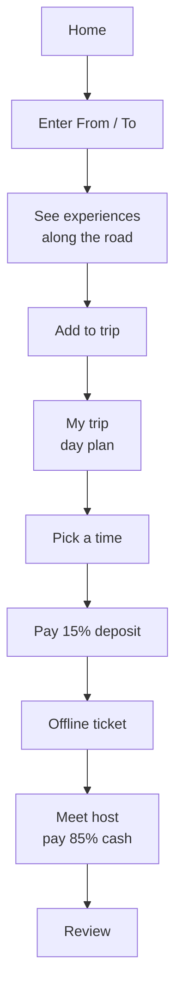
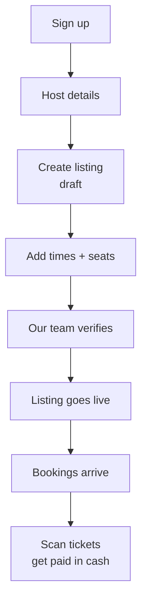

# 2. User flows

The app should have **one clear path** for each job. Every screen has **one main button**. If a screen doesn't help one of these flows, it doesn't belong.

## The main flow (traveller)

## Flow 1 — Plan a trip

| Step | Screen | What the traveller does | Main button |
| --- | --- | --- | --- |
| 1 | Home | Types **From** and **To**. Date, start time and travel mode are pre-filled. | **Show what's on the way** |
| 2 | Route results | Map + list in road order. Picks a route chip (Fastest / Scenic / No expressway). Filters by category. | **+ Add** on a card |
| 3 | Sign-in sheet (first Add only) | Signs in with email or Google, in a sheet over the page. Comes back to the same spot. | **Continue** |
| 4 | Route results | Keeps adding. Sees "Added · arrive Ella 17:40 (+40 min) · Undo". | **Open my trip** |

**Rules**
- Browsing never needs a login. Saving a trip does.
- Cards show distance from the road: "On the way" (≤ 5 km) or "~12 km off your road".
- Only real data. No fake ratings, counts or "popular" badges.

## Flow 2 — My trip

| Step | Screen | What the traveller does | Main button |
| --- | --- | --- | --- |
| 1 | My trip | Sees the day plan: drive times, arrival times, each stop. | **Book** on a stop |
| 2 | My trip | Drags to reorder, removes stops, renames the trip. | — |
| 3 | My trip | Reads warnings in plain words: "You arrive 15:10, class starts 15:00. 2 later times fit." | **Pick another time** |

**Every stop shows its state clearly**

| State | Label |
| --- | --- |
| Not booked | "Not booked yet — no ticket" |
| Booking not open | "Booking opens on 3 Dec" (14 days ahead) |
| Paying | "Paying… 8:42 left" |
| Booked | "Booked ✓" + ticket link |
| Full | "Full — see other times" |

## Flow 3 — Book and pay

| Step | Screen | What the traveller does | Main button |
| --- | --- | --- | --- |
| 1 | Experience page | Picks a date, time and guests. Sees total, deposit and cash balance. | **Continue** |
| 2 | Review and pay | Checks the amount. Nothing is held yet. | **Pay deposit** |
| 3 | PayHere checkout | Pays by card. Seats are held for 10 minutes. | (PayHere) |
| 4 | Confirmation | Gets the ticket + email. Ticket saves for offline. | **View ticket** |

**Example:** cooking class $40 × 2 people = $80 → pay **$12 now**, **$68 cash** to the host on the day.

## Flow 4 — On the day

| Step | Screen | What happens | Main button |
| --- | --- | --- | --- |
| 1 | Today | Today's stops, in order, with times. Works offline. | **Open in Google Maps** |
| 2 | Ticket | Shows QR code + booking code. Works offline. | **Chat on WhatsApp** |
| 3 | At the host | Host scans the QR or types the code. Booking is complete. | — |
| 4 | After | Traveller is asked for a review (and has 24 h to report a problem). | **Write a review** |

## Flow 5 — Become a host

| Step | What happens | Who |
| --- | --- | --- |
| 1 | Registers as a host. Starts as **pending**. | Host |
| 2 | Creates a listing: title, price, photos, map pin, up to 3 short videos. | Host (or our team) |
| 3 | Adds dates, times and seats (at least the next 14 days). | Host (or our team) |
| 4 | Verification: ID + phone, visit or video call, photos, licence if needed, safety check, mystery-shopper test. | Our team |
| 5 | Listing goes **live**. Host sees upcoming bookings. | — |
| 6 | Scans tickets on the day, collects the cash balance. | Host |

**Hosts who aren't online:** our team creates and runs their listing for them. Most village hosts start this way.

## Flow 6 — Our team (staff portal)

| Job | Who | Notes |
| --- | --- | --- |
| Add offline hosts and their listings | Staff | Most supply comes this way |
| Add places and curated routes | Staff | Data, not code |
| Approve host videos | Staff | Clips show only after approval |
| Verify / suspend hosts | Admin | |
| Refunds | Admin | Manual, after a quick check |
| Invite staff, read audit log | Admin | Every change is logged |

Security: invite only, two-factor login, auto logout after 30 min idle.

## Cancellations

| Situation | Result |
| --- | --- |
| Traveller cancels **more than 48 h** before | Full deposit back |
| Traveller cancels **less than 48 h** before, or doesn't come | Deposit kept |
| Host cancels | Full refund, host ranking drops |
| Bad weather (outdoor, admin decides) | Full refund |

## Screens list (the whole app)

| Area | Screens |
| --- | --- |
| Discover | Home · Route results · Discover (browse) · Experience page · Place page |
| Trips | My trips · Trip day plan · Today |
| Booking | Review and pay · Confirmation · Ticket · My bookings |
| Account | Sign in sheet · Profile · Saved (wishlist) |
| Host | Host dashboard · Listing editor · Calendar · Scan ticket |
| Staff portal | Hosts · Listings · Places · Routes · Videos · Refunds · Team · Audit log |
