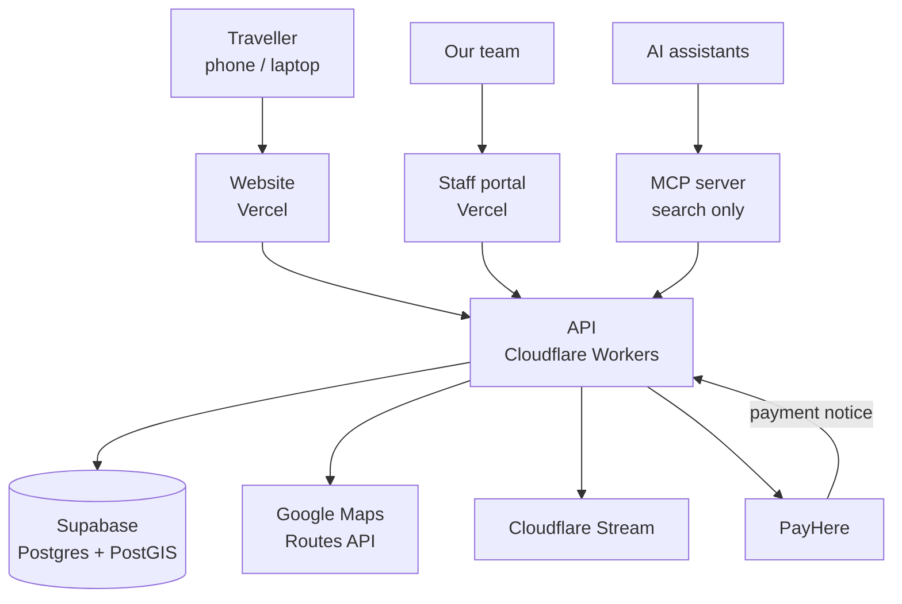

# 6. Technology

## Stack

| Part | Tool | Why |
| --- | --- | --- |
| Website (installable app) | Next.js + Tailwind on **Vercel** | Fast, works offline, Google can read it |
| Staff portal | Next.js on Vercel (own address) | Separate and locked down |
| API | Hono on **Cloudflare Workers** | Runs close to users, cheap at small scale |
| Database | **Supabase** PostgreSQL + PostGIS | Map / distance search built in |
| Login | Supabase Auth (email, Google soon) | |
| Photos | Supabase Storage | |
| Host videos | **Cloudflare Stream** | Plays well on weak signal |
| Maps and roads | **Google Maps Platform** (Maps JS, Routes API) | Most accurate roads in Sri Lanka |
| Place search | OpenRouteService | Cheap, good coverage |
| Payments | PayHere | Local, accepts foreign cards |
| Email | Resend | |
| AI assistants | MCP server (search only) | Claude / ChatGPT can find our experiences |
| Quality | Vitest, Playwright, GitHub Actions, Sentry, PostHog | Tests, errors, analytics |

## How it fits together

## Built for scale and safety

| | |
| --- | --- |
| **One codebase, many countries** | Countries, places, currencies and routes are data |
| **No double booking** | Seats are locked at payment |
| **Safe to repeat** | Double taps and repeated payment notices never charge twice |
| **Offline** | Tickets, trip route and map open with no signal |
| **Security** | Staff use two-factor login; every staff change is logged and can't be edited |
| **Smart caching** | Road routes cached 29 days (Google's limit) to keep map costs low |
| **Three environments** | Dev → QA → Production, each with its own database and keys |

## Running costs

Most tools have free tiers that cover the beta. Costs grow with use. The biggest variable costs:

| Cost | Grows with |
| --- | --- |
| Google Maps (map loads, route requests) | Number of trip searches |
| Supabase (database, storage) | Data and traffic |
| Cloudflare (Workers, Stream minutes) | API calls and video views |
| Vercel | Website traffic |
| PayHere fees | Number of bookings |

Startup cloud programs help us cover these as we grow — see [Partnerships](08-funding.md).
